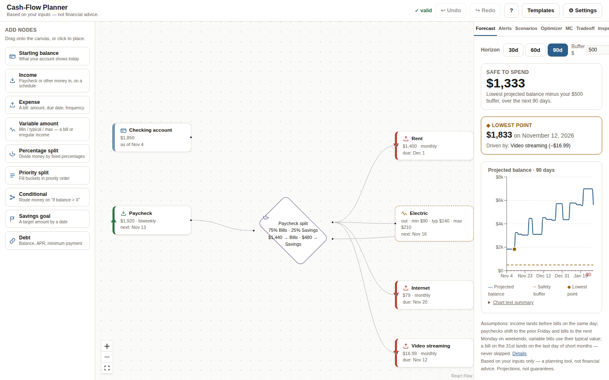
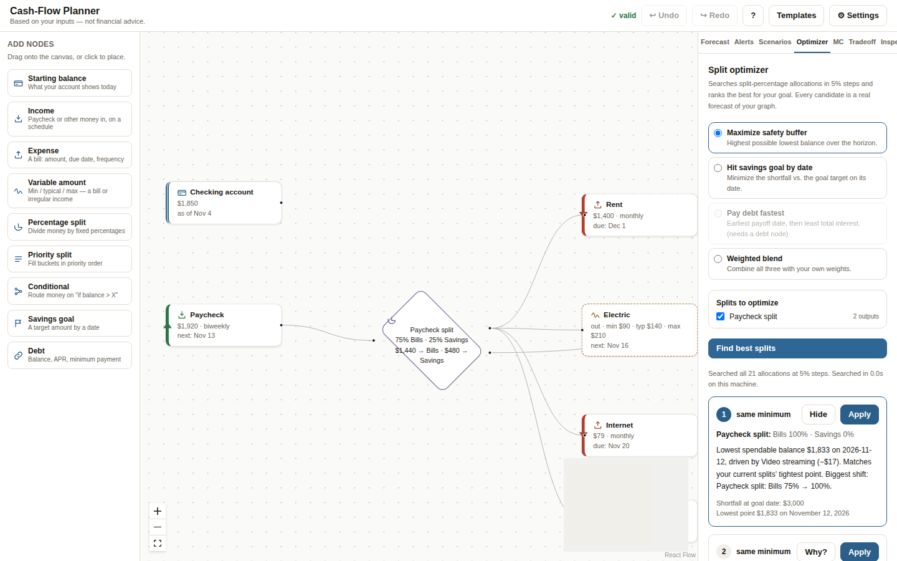
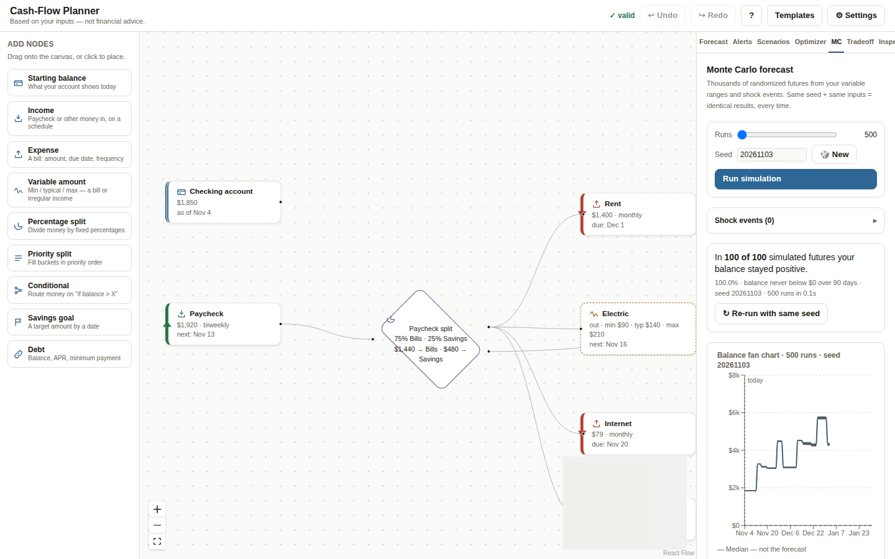
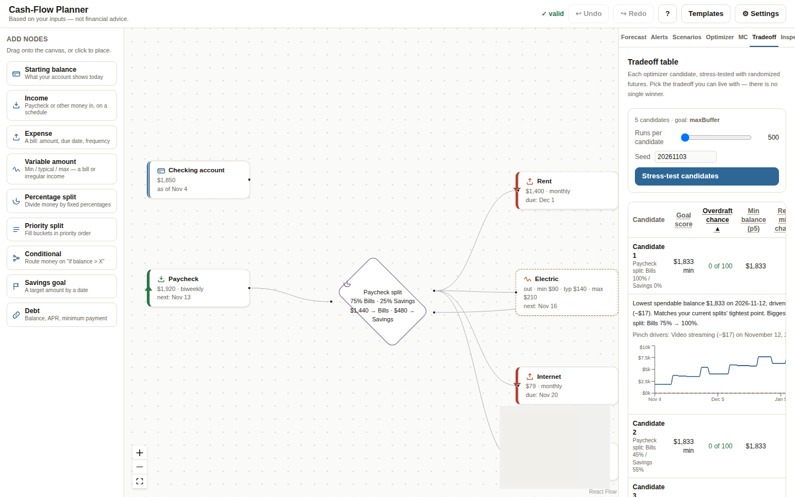
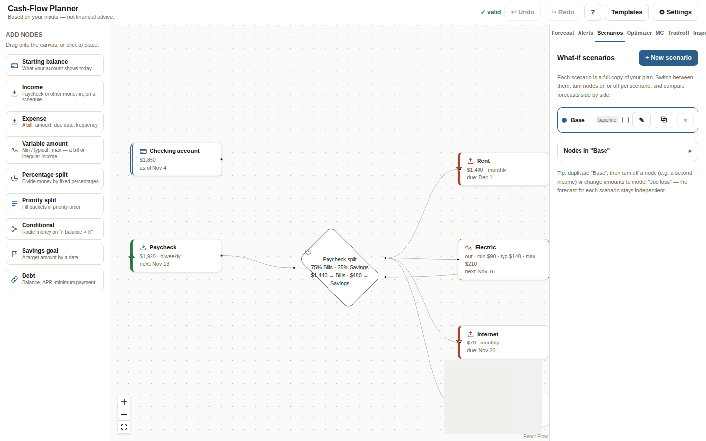
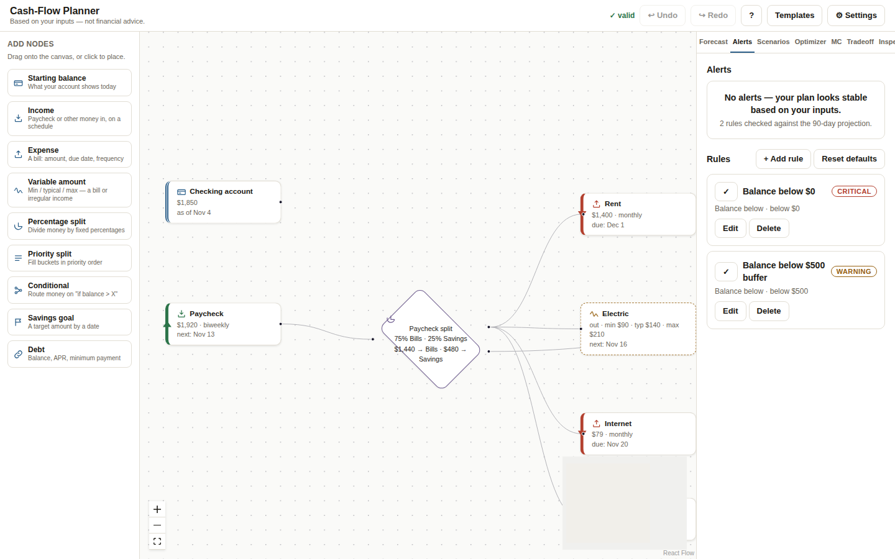
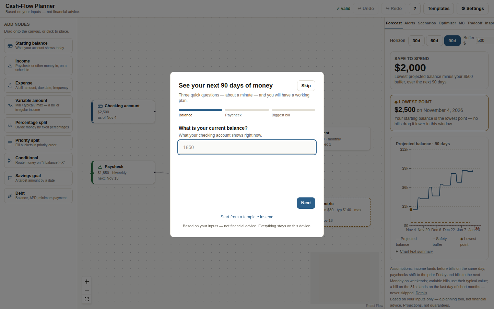

# Cash-Flow Planner

A node-based personal cash-flow planner. Build your money as a flow graph — paycheck in, splits, bills out — and see your projected daily balance for the next 90 days, find the best paycheck split with a brute-force optimizer, and stress-test the plan with Monte Carlo simulation.

**Local-only and privacy-first:** no backend, no accounts, no analytics, no network calls with user data. Your plan lives in your browser's localStorage (plus JSON files you explicitly export).

## Quick start

**Prerequisites:** Node.js 18+ and npm.

```bash
npm install
npm run dev        # start the dev server (http://localhost:5173)
npm test           # Vitest unit suite (engine)
npm run test:e2e   # Playwright end-to-end suite (headless Chromium)
npm run build      # typecheck + production build
```

## Features

| | |
|---|---|
|  | **Node canvas** — drag paycheck, bills, splits, goals, and debts from the palette; connect them into a money-flow graph. Full keyboard support (Tab to nodes, Enter to edit, Delete to remove, Esc to close). On phones the canvas becomes a grouped node list with the same editor. |
|  | **90-day forecast** — day-by-day balance walk with safe-to-spend, lowest point, pinch-point drivers ("which bills caused it"), and a text summary of the chart. |
|  | **Split optimizer** — brute-forces paycheck-split percentages in 5% steps against your goal (maximize buffer, hit a savings target, pay debt fastest, or a weighted blend) and explains each of the top 5 candidates. |
|  | **Monte Carlo** — thousands of randomized futures from your variable bill ranges and shock events (car repair, missed paycheck…), with a fan chart, frequency-framed odds, and drill-down into failing runs. Seeded RNG: same seed + same inputs = identical results. |
|  | **Tradeoff table** — every optimizer candidate stress-tested with Monte Carlo, so you can pick the tradeoff you can live with. |
|  | **What-if scenarios** — named copies of your plan (baseline + alternatives), toggle nodes per scenario, compare forecasts side by side. |
|  | **Alerts** — rules like "balance below $500" checked against the projection, with add/edit/delete and defaults reset. |
|  | **Guided first run** — three questions build a working plan in under a minute, or start from one of 3 templates. |

Also: light/dark/system themes, undo/redo, JSON export/import, assumptions panel + "not financial advice" disclaimer on every result view, reduced-motion support.

## Architecture

```
src/
  engine/        Pure TypeScript simulation core — no React, no DOM.
                 forecast, optimizer, Monte Carlo, alerts, recurrence rules,
                 date math, seeded RNG. Covered by the Vitest suite.
  canvas/        React Flow canvas (custom node components), palette,
                 inspector, and the mobile list-view fallback.
  panels/        Result views: Forecast, Optimizer, Monte Carlo, Tradeoff,
                 Scenarios, Alerts, Settings, Assumptions.
  store/         Zustand stores: graph, scenarios, assumptions, results, settings.
  workers/       simPool — Web Worker pool for Monte Carlo / tradeoff runs,
                 so heavy simulation never blocks the UI.
  templates/     3 starter templates (renter, couple, freelancer).
```

The engine is deliberately framework-free: `src/engine/` imports nothing from React, and a Vitest gate enforces it. Heavy simulation runs in a Web Worker; the deterministic forecast and optimizer run on the main thread (both sub-second).

## How the simulation works

**Deterministic forecast.** Starting from your "as of" balance, the engine walks day by day for 90 days, posting each node's events: income on its schedule, bills on their due dates, splits routing each paycheck dollar to outputs, debts accruing interest. The lowest balance in the window is the **pinch point**; the engine ranks which outflow events in the week before it drove the dip (**drivers**), and **safe to spend** is the lowest projected balance minus your safety buffer.

**Scheduling details.** Bi-weekly and semi-monthly are distinct schedules. Paychecks that land on a weekend shift to the prior Friday; bills shift to the next Monday (configurable in Assumptions). A bill dated the 31st lands on the last day of shorter months — never skipped. Income posts before bills on the same day.

**Monte Carlo.** Each run replays the 90-day walk with variable bills sampled from their min/typical/max via a **triangular distribution** (typical = mode), and shock events fired by probability. Randomness comes from **mulberry32**, a seeded PRNG — the seed is shown in the UI and re-running with the same seed reproduces the run bit-for-bit.

**Optimizer.** For each percentage-split node you select, it tries every allocation in 5% steps (for 2 outputs: 0/100 … 100/0), scores each full-forecast candidate against your goal, and returns the top 5 with plain-language explanations.

## What this app does NOT do (limits)

- **No bank sync, ever.** Manual entry only — this is a deliberate privacy position, not a missing integration.
- **No taxes, interest-rate changes, market moves, or spending you haven't entered.** The projection only knows what you told it.
- **Not financial advice.** Every result is framed as "based on your inputs" with the assumptions visible next to the number.
- **Single currency, USD-style formatting.** Multi-currency is out of scope for v1.
- **Weekend-shift and same-day ordering rules are simplifications** — real banks vary. Check the Assumptions panel for the full list.

## Testing

- `npm test` — 181 Vitest tests: engine correctness (forecast math, recurrence edge cases like Feb 31st, optimizer bounds, RNG determinism, no-network gate asserting the engine makes zero `fetch`/`XMLHttpRequest` calls).
- `npm run test:e2e` — 7 Playwright tests in headless Chromium: onboarding → forecast, palette add → forecast updates, optimizer run → apply candidate, Monte Carlo 500 runs → fan chart + same-seed determinism, export → wipe → import round-trip, zero non-localhost network requests, mobile list view.

## Screenshots

All screens in `docs/screenshots/`: canvas, forecast, optimizer, Monte Carlo, tradeoff, scenarios, alerts, settings, onboarding — light and dark desktop, plus mobile views.
